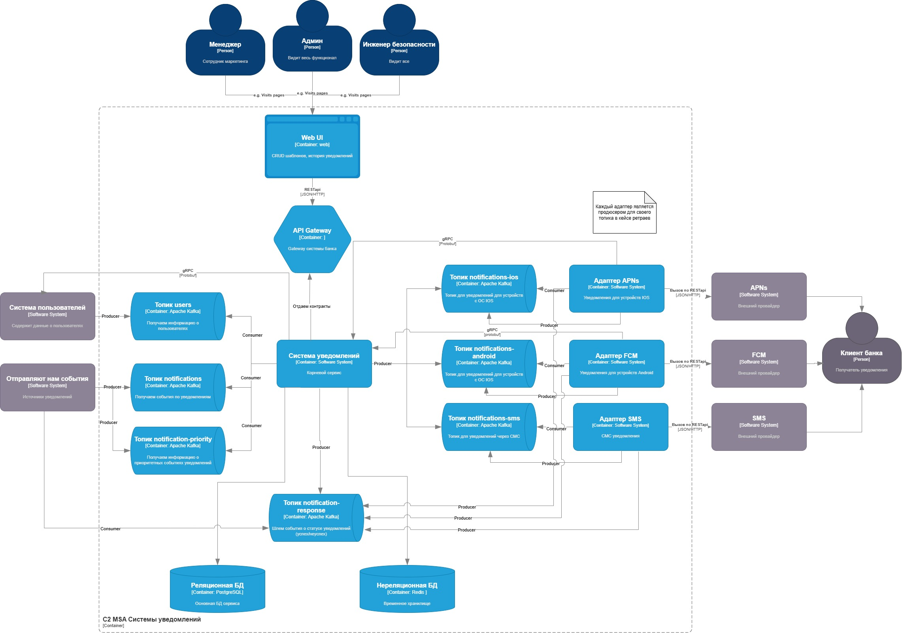

# Архитектура системы уведомлений

## Оглавление

- [1. C4 Container Diagram](#1-c4-container-diagram)
- [2. Общее описание](#2-общее-описание)
- [3. Основные компоненты](#3-основные-компоненты)
- [4. Взаимодействие компонентов](#4-взаимодействие-компонентов)
- [5. Хранение данных](#5-хранение-данных)

## 1. C4 Container Diagram

Диаграмма отражает контейнерную архитектуру системы уведомлений, включая внутренние компоненты, внешние системы, брокер сообщений и используемые хранилища данных.

## 2. Общее описание

Система уведомлений предназначена для обработки событий от внешних систем и отправки уведомлений клиентам банка через Push и SMS.

Взаимодействие между компонентами реализовано с использованием:

- **Apache Kafka** — асинхронная передача событий, задач на отправку уведомлений и результатов доставки.
- **gRPC (Protocol Buffers)** — взаимодействие между внутренними компонентами.
- **REST API (JSON/HTTP)** — взаимодействие Web UI с API Gateway и адаптеров с внешними провайдерами.

Для доставки уведомлений используются APNs, FCM и SMS-провайдер.

## 3. Основные компоненты

| Компонент | Ответственность |
|---|---|
| **Web UI** | Интерфейс управления шаблонами и просмотра истории уведомлений. |
| **API Gateway** | Единая точка входа для запросов Web UI, маршрутизация запросов к внутренним сервисам. |
| **Система уведомлений (Core Service)** | Основная бизнес-логика обработки событий, формирования и отправки уведомлений. |
| **Топик users** | Получение информации о пользователях из системы пользователей. |
| **Топик notifications** | Получение событий, инициирующих отправку уведомлений. |
| **Топик notification-priority** | Получение информации о приоритетных событиях уведомлений. |
| **Топик notifications-ios** | Передача задач на отправку уведомлений на устройства iOS. |
| **Топик notifications-android** | Передача задач на отправку уведомлений на устройства Android. |
| **Топик notifications-sms** | Передача задач на отправку SMS. |
| **Адаптер APNs** | Интеграция с APNs для отправки Push на устройства iOS. |
| **Адаптер FCM** | Интеграция с FCM для отправки Push на устройства Android. |
| **Адаптер SMS** | Интеграция с SMS-провайдером. |
| **Топик notification-response** | Получение ответов о статусах отправки уведомлений. |
| **Реляционная БД (PostgreSQL)** | Основное хранилище данных системы уведомлений. |
| **Нереляционная БД (Redis)** | Временное хранение данных. |

## 4. Взаимодействие компонентов

### 4.1. Получение событий

Внешние системы публикуют события в Apache Kafka.

Система уведомлений получает события из топиков `notifications` и `notification-priority`, а информацию о пользователях — из топика `users`.

### 4.2. Обработка уведомления

Core Service обрабатывает полученное событие и определяет дальнейший маршрут отправки уведомления.

Для отправки используются отдельные Kafka-топики в зависимости от канала и платформы получателя:

- `notifications-ios` — Push для iOS;
- `notifications-android` — Push для Android;
- `notifications-sms` — SMS.

### 4.3. Отправка уведомления

Соответствующий адаптер получает задачу из Kafka и обращается к внешнему провайдеру:

- APNs — для устройств iOS;
- FCM — для устройств Android;
- SMS-провайдер — для SMS.

Каждый адаптер реализован как отдельный сервис и отвечает за взаимодействие со своим внешним провайдером.

### 4.4. Обработка результатов отправки

Адаптеры публикуют ответы о результатах отправки в топик `notification-response`.

Core Service получает эти сообщения для дальнейшей обработки статусов уведомлений.

### 4.5. Управление через Web UI

Менеджер, администратор и инженер безопасности взаимодействуют с системой через Web UI.

Запросы поступают в API Gateway по REST API, после чего передаются во внутреннюю систему уведомлений по REST API.

Через Web UI предусмотрены управление шаблонами и просмотр истории уведомлений. Права доступа различаются в зависимости от роли пользователя.

## 5. Хранение данных

В архитектуре предусмотрены два хранилища:

| Хранилище | Назначение |
|---|---|
| **PostgreSQL** | Основная реляционная база данных системы уведомлений. |
| **Redis** | Временное хранение данных, использование скользящего окна. |

